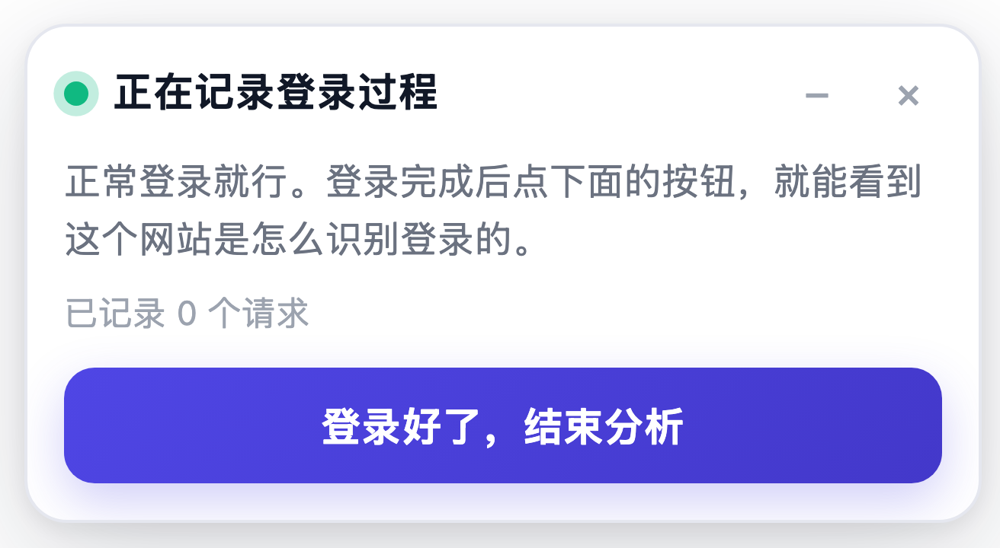
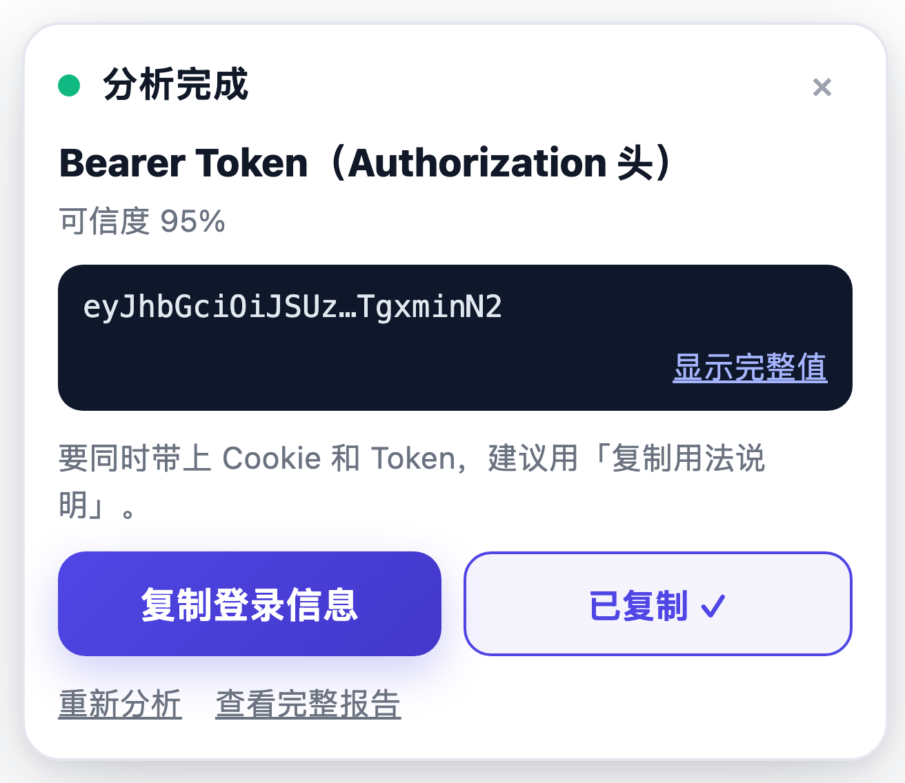
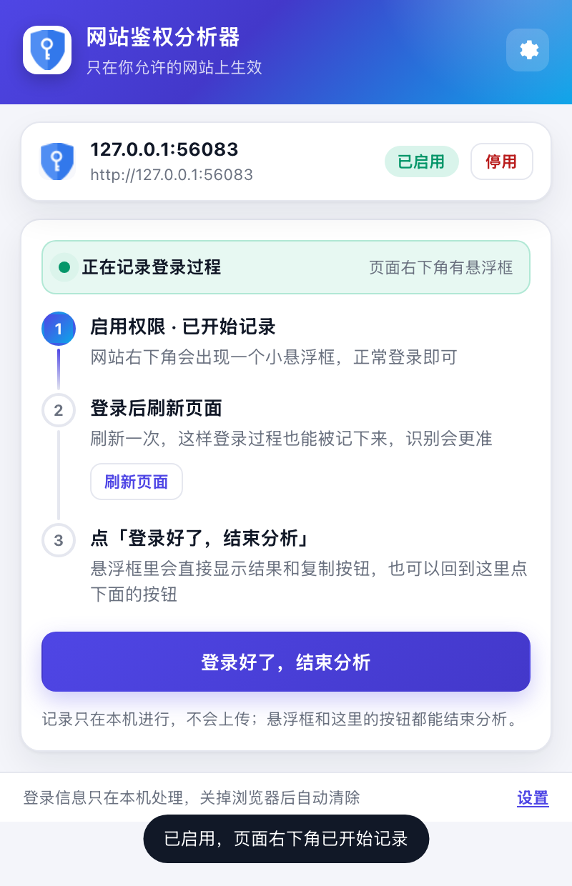
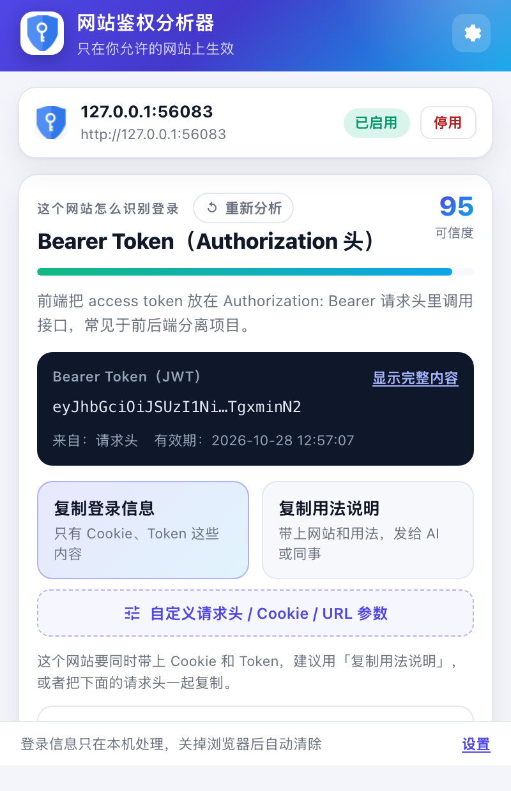
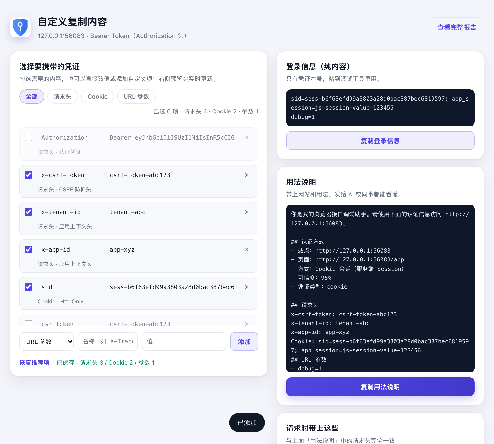
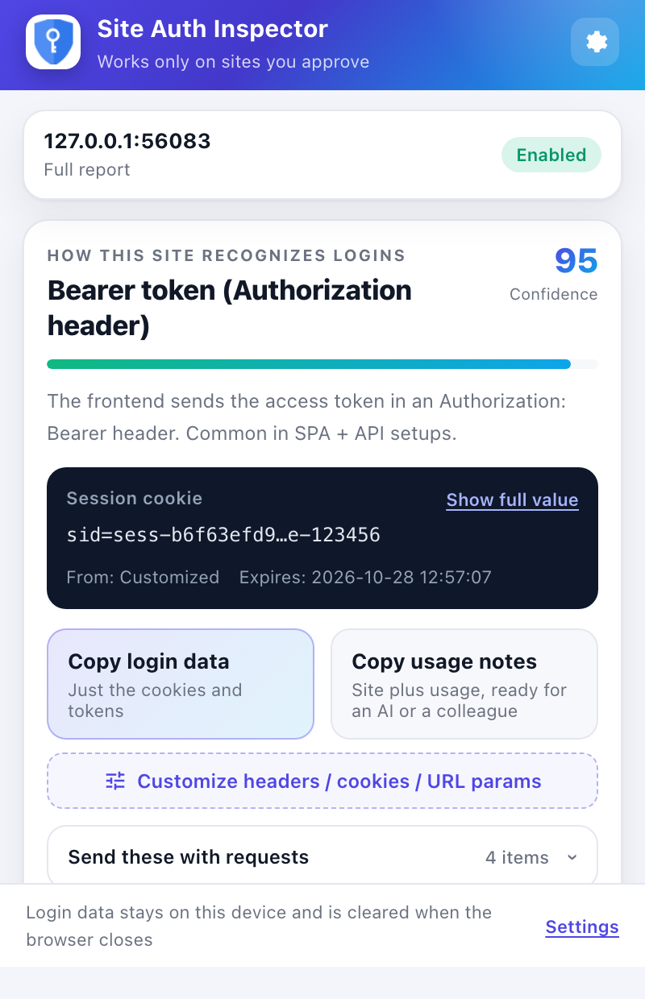
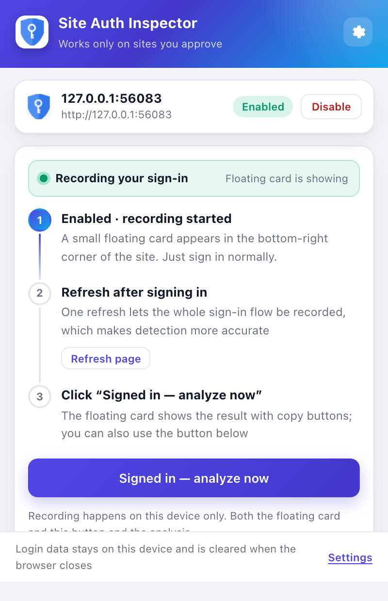
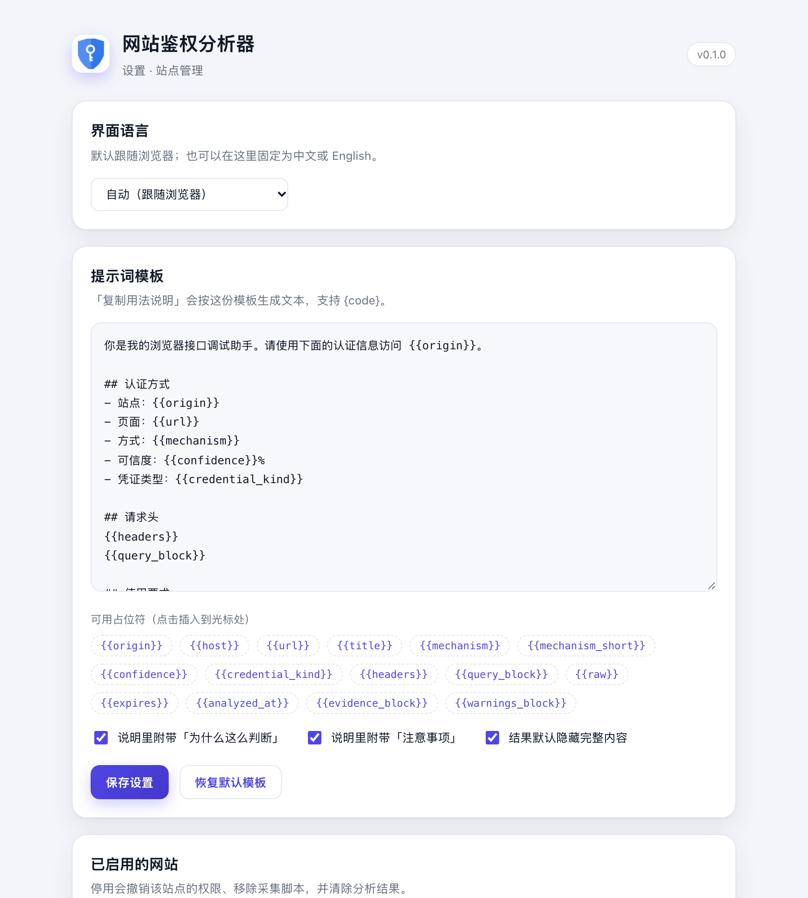

# 网站鉴权分析器 · Chrome Auth Inspector

一个按站点启用的 Chrome 扩展（Manifest V3）：点「启用」→ 在权限框里授权 → **自动开始记录**，网页右下角出现一个悬浮框 → 正常登录 → 在悬浮框点「**登录好了，结束分析**」，立即识别这个网站用的是哪种登录鉴权方式，并给出两种可复制的文本：

1. **复制登录信息**：只有 Cookie / Token 本身，自己粘到调试工具里就能用；
2. **复制用法说明**：带上网站、请求时需要的头部和用法约束，直接发给 AI 或同事都能看懂。

---

## 界面预览

**网页里的悬浮框**：启用后立即出现，登录过程中一直显示记录到的请求数，登录完成后一键结束：

| 记录中 | 分析完成 |
| --- | --- |
|  |  |

**扩展弹窗**：

| 记录引导 | 分析结果 |
| --- | --- |
|  |  |

自定义要携带的内容（逐项勾选、改值、实时预览）：



英文界面（自动跟随浏览器语言，也可手动切换）：

| 分析结果 | 记录引导 |
| --- | --- |
|  |  |

设置页（提示词模板 / 站点管理）：



---

## 目录

- [功能特性](#功能特性)
- [安装](#安装)
- [使用流程](#使用流程)
- [两种复制方式](#两种复制方式)
- [高级自定义](#高级自定义)
- [多语言](#多语言)
- [能识别哪些鉴权方式](#能识别哪些鉴权方式)
- [工作原理](#工作原理)
- [隐私与安全](#隐私与安全)
- [设置页](#设置页)
- [已知限制](#已知限制)
- [开发与测试](#开发与测试)

---

## 功能特性

- **按站点启用，最小权限**：默认没有任何站点权限，只有在当前站点点击「启用」并确认权限框后，才会申请该域名的可选权限（`optional_host_permissions`）。
- **工具栏状态换成绿色系图标**：站点启用 / 已分析后，工具栏图标整体切成绿色盾牌（`icon16-on.png` 等），颜色本身就是状态；悬停提示会显示「已启用」或「记录中」。图标用 `imageData` 设置（部分环境会拒绝 `setIcon({ path })`），两种方式都失败时才退回一个很小的 `●` 角标。
- **权限弹窗 + 悬浮框引导**：启用时由 Chrome 弹出真正的权限确认框；授权后立即开始记录，并在网页右下角显示悬浮框，登录完成后点悬浮框即可结束分析，**不用再回到弹窗**。
- **悬浮框直接出结果**：分析完成后悬浮框展示识别出的登录方式、可信度、默认隐藏的登录信息，以及「复制登录信息」「复制用法说明」两个按钮；也可以收起成一枚小胶囊，不挡页面。
- **自动识别登录方式**：综合 Cookie、localStorage / sessionStorage、页面发出的请求头、登录响应、OAuth / SAML / CAS / ADFS 线索等信号打分，给出登录方式、可信度、判断理由和风险提示。
- **一键重试**：有分析结果时，结果卡片头部（小标题同一行）出现「重新分析」小胶囊按钮，点和标题同一行、不单独占一行；点一次直接再分析当前页面，识别到凭证就结束，不会在页面右下角闪出记录框；只有没识别到（比如登录态过期）时才自动回到记录状态并显示悬浮框，登录后再结束分析即可。
- **操作都挂在内容块里**：状态徽标（已启用 / 已授权）和「停用」同处站点卡片右侧，「重新分析」挂在结果卡片头部；页面里没有任何“只剩一个按钮”的独立横条。
- **两种复制格式**：登录信息、用法说明；说明模板可在设置页自定义占位符。
- **高级自定义**：结果页复制按钮下方就是一级入口「自定义请求头 / Cookie / URL 参数」，可以逐项勾选 / 修改要携带的内容，也能自己加一行（比如额外租户头、GET Token），右侧实时预览三种复制内容，选择自动保存到当前分析结果。
- **默认脱敏展示**：界面里凭证默认打码，需要时点「显示完整值」；复制时始终是原始值。
- **凭证只存会话**：完整分析结果放在 `chrome.storage.session`，浏览器关闭自动清除；长期存储里只有站点列表和设置，不含凭证。
- **跨域登录提示**：检测到 `api.example.com` / `login.example.com` 等同站相关域名时，可一键「补充授权」再分析。
- **中英双语，自动跟随浏览器**：界面、悬浮框、默认说明模板都会按浏览器语言切换（中文 / 英文），无需手动设置；可在扩展页面加 `?lang=en` 预览英文界面。

---

## 安装

1. 打开 Chrome，地址栏输入 `chrome://extensions`；
2. 右上角打开「开发者模式」；
3. 点击「加载已解压的扩展程序」，选择本目录 `chrome-auth-plugin`；
4. 建议把扩展固定到工具栏（拼图图标 → 固定）。

> 需要 Chrome 116+（用到了 MV3 动态内容脚本、`chrome.storage.session` 等能力）。

---

## 使用流程

1. 打开目标网站（登录前或登录后都可以），点击工具栏上的扩展图标；
2. 点击「**启用此网站**」，Chrome 弹出权限确认框，选择「允许」——此时**自动开始记录**，网页右下角出现悬浮框（不用刷新，启用后立即注入）；
3. 建议顺手点一下「**刷新页面**」：刷新后采集脚本从页面加载第一刻就生效，登录接口与跳转过程都不会漏；
4. 正常**完成登录**。悬浮框会实时显示「已记录 N 个请求」，可以点「−」收起成小胶囊，不影响操作；
5. 登录完成后，点悬浮框里的「**登录好了，结束分析**」（或回到弹窗点同名按钮），1～2 秒后悬浮框直接展示结果；
6. 复制「登录信息」或「用法说明」即可；需要看判断理由 / 请求头时点「查看完整报告」；要重来一遍就点顶部的「重新分析」；
7. 不需要时点悬浮框的「×」或弹窗里的「停用」，会撤销该站点权限并清除分析结果。

> 如果结束分析时提示「暂未识别到登录凭证」，说明此刻还没登录成功——悬浮框里点「继续记录」，登录完成后再结束即可。
> 记录状态最多保留 2 小时，超时后悬浮框会自动消失，弹窗里「重新开始记录」即可恢复。
> **更新扩展后**：先在 `chrome://extensions` 点一次「重新加载」，再刷新已打开的目标页面（或直接重新打开扩展弹窗，会自动补注入），悬浮框即可恢复。

---

## 两种复制方式

以 Cookie 会话为例：

**① 复制登录信息（纯内容）**

```text
JSESSIONID=8A3F...D91C; csrftoken=4f1c...9a2b
```

**② 复制用法说明**

```markdown
你是我的浏览器接口调试助手。请使用下面的认证信息访问 https://example.com。

## 认证方式
- 站点：https://example.com
- 页面：https://example.com/dashboard
- 方式：Cookie 会话（服务端 Session）
- 可信度：91%
- 凭证类型：会话 Cookie

## 请求头
Cookie: JSESSIONID=8A3F...D91C; csrftoken=4f1c...9a2b

## 使用要求
1. 调用该站点接口时必须带上上面列出的全部请求头；若同时出现 Cookie 与 Token，请一并携带。
2. 收到 401 或 403 说明凭证已失效，请提示我重新登录后再分析，不要尝试猜测或构造凭证。
3. 只访问 https://example.com 及其同源接口，不要把这些凭证发送到其他域名。
4. 不要在回复、日志、代码仓库或公开内容中输出上述凭证。

## 凭证时效
2025-06-01 12:00:00

## 为什么这么判断
1. 识别到 2 个疑似会话 Cookie（JSESSIONID（HttpOnly）、csrftoken）
2. 捕获到 1 个疑似登录 / Token 相关请求
...

## 注意事项
- [提示] 站点同时使用 Cookie 与 Token，调用接口时需一并携带，建议使用「复制用法说明」。
- 分析时间：2025-06-01 09:30:00
```

悬浮框里点「复制登录信息 / 复制用法说明」效果与弹窗一致，只是内容更精简；完整弹窗里还有「请求时带上这些」折叠区，可以单独复制某一条请求头的值。

---

## 高级自定义

分析结果默认给出一套推荐组合（认证头 + 必要的 Cookie / CSRF 头），但真实场景经常需要自己挑：

- **按项勾选**：请求头、Cookie、URL 参数分三类列出，取消勾选就立刻从复制内容里移除；
- **直接改值**：每一行的值都可以就地编辑，比如把过期的 Cookie 换成新的、把租户头改成另一个环境；
- **添加自定义项**：支持补一条请求头（如 `X-Tenant-Id`）、Cookie 或 URL 参数（如 `?access_token=...`）；
- **实时预览**：「登录信息 / 用法说明 / 请求时带上这些」三份内容随勾选同步更新；
- **自动保存**：改动写入当前分析结果（`chrome.storage.session`），回到弹窗复制时用的就是自定义后的内容；重新分析会回到推荐组合。

入口：结果页两个复制按钮下方的「**自定义请求头 / Cookie / URL 参数**」（一级入口，不需要展开折叠区）；也可以直接打开 `src/customize.html?host=<站点域名>`。

勾选 URL 参数时，`{{query_block}}` 会生成「## URL 参数」段落，`{{url}}` 仍是页面地址，便于直接拼到请求上。

---

## 多语言

- **默认自动识别**：根据 `chrome.i18n.getUILanguage()`（浏览器界面语言）选择中文或英文。
- **也可以手动指定**：设置页顶部「界面语言」可选 `自动（跟随浏览器）` / `中文` / `English`，保存后立即生效（弹窗、悬浮框、自定义页、说明模板一起切换），创建时间与模板都会按新语言重建。
- **覆盖范围**：弹窗、悬浮框、设置页、自定义页、按钮与提示、判断依据 / 注意事项、机制名称、默认说明模板，全部中英双语。
- **预览另一种语言**：在扩展页面后加 `?lang=en`（或 `?lang=zh`），例如 `chrome-extension://<id>/src/popup.html?lang=en`（临时预览，不改设置）。
- **报告本地化**：分析结果以中文原文保存在会话存储里，页面渲染时按当前语言实时翻译；切换语言后重新打开弹窗即可看到新语言（悬浮框文案由后台按设置下发，无需重新分析）。
- **新增语言**：复制 `src/lib/locales/zh.js` 为 `src/lib/locales/<code>.js` 并翻译，在 `src/lib/i18n.js` 的 `DICTS` 注册；`_locales` 下补对应 `messages.json`；`tests/i18n.test.mjs` 会校验 key 完整性与占位符一致性。

> 图标：`npm run icons` 会先用无头 Chrome 把 `assets/logo.svg` 渲染成 1024px 位图（原色 + 绿色），再生成各尺寸图标；需要本机装了 Chrome，可用 `CHROME_PATH` 指定路径。

---

## 能识别哪些鉴权方式

| 方式 | 典型特征 |
| --- | --- |
| Cookie 会话 | `JSESSIONID` / `PHPSESSID` / `ASP.NET_SessionId` / `connect.sid` / `laravel_session` 等 HttpOnly 会话 Cookie |
| JWT 会话 Cookie | Cookie 值是 `eyJ...` 结构的 JWT，会解析 `exp` / `iss` / `aud` |
| Bearer Token | 捕获到 `Authorization: Bearer ...` 请求，或 localStorage / sessionStorage 中的 `access_token` |
| OAuth 2.0 / OIDC | `id_token`、`refresh_token`、`oauth2/authorize` 端点、OIDC 用户存储（`oidc.user:`、`msal.`、`sb-*-auth-token`、`firebase:authUser`）等 |
| 自定义 Token 头 | `X-Auth-Token` / `X-Access-Token` / `X-Token` 等 |
| API Key | `X-API-Key` / `Api-Key` / `X-Auth-Key` 等 |
| HTTP Basic | `Authorization: Basic base64(user:password)`，并提示「等同于账号密码」 |
| SAML SSO | `SAMLRequest` / `SAMLResponse` / `/adfs/` / `shibboleth` / Ping Identity 等 |
| CAS SSO | `/cas/login`、`ticket=ST-`、`serviceValidate` |
| Negotiate / NTLM | 响应头 `WWW-Authenticate: Negotiate / NTLM` |
| 其他线索 | Google / Microsoft / Okta / Auth0 / Keycloak / OneLogin 等 IdP 请求、页面 SDK 脚本 |

实战中常见的几个细节：

- **会忽略无效的 Bearer**：很多前端 SDK 在没拿到 token 时会发出 `Authorization: Bearer` 或 `Bearer undefined`，这类占位值不会被当作凭证，也不会进入复制内容，判断依据里会标注「忽略无效的 Bearer 请求头」。
- **Cookie 名称兼容 camelCase**：`accessToken`、`sessionToken`、`authToken` 等同样视为会话 Cookie；Cookie 值是 JWT 时直接识别为「JWT 会话 Cookie」并解析 `exp`。
- **补充读取 `document.cookie`**：`chrome.cookies` 读不到的 Cookie（例如前端 JS 写入的、或当前子域授权覆盖不到的）会由页面侧补上。
- **多租户上下文头**：`x-tenant-id`、`x-app-id`、`h-tenant-id`、`ao-user-timezone`、`x-requested-with` 等会被一并列入「推荐请求头」——这类 API 少一个头往往直接 403。
- **父域名提示**：子域读不到任何 Cookie 时（如 `flow.example.com`），会建议补充授权父域名 `example.com`，因为 HttpOnly 登录 Cookie 很可能设置在父域。
- **同站 Authorization 头优先于 Cookie 数量**：只要在本站（含同站子域）的接口请求里真的看到了 `Authorization: Bearer <有效 Token>`，就按请求头识别，不会因为「Cookie 很多」而被判成 Cookie 会话；第三方域上的 Token 不参与这个判断。
- **识别重复保存的 Token**：有些前端会把 Token 再塞进 Cookie（如 `Authorization=Bearer%20xxx`）。这类 Cookie 会被识别为「同一个 Token 的副本」，不重复计入 Cookie 证据，也不会出现在复制的 Cookie 头里。

> Cookie 方式会同时带上 CSRF Cookie 与其它 HttpOnly 功能 Cookie（例如 `sid=…; csrftoken=…`），
> 避免复制出来因为少一条 Cookie 而被 403。

结果会附带**可信度**与**为什么这么判断**；多个机制并存时（例如 Cookie + Bearer）会提示「同时携带」，并在用法说明里列出全部请求头。

---

## 工作原理

```text
popup（用户交互）
  │  1) chrome.permissions.request(按站点 origin)
  │  2) CA_ENABLE_SITE → 注册动态内容脚本 + 标记「记录中」+ 立即注入当前页面
  ▼
background service worker
  │  3) CA_ANALYZE：读 Cookie（chrome.cookies）+ 向页面要存储/请求
  │  4) analyzer.js 打分 → 生成报告 → attachCopies()
  ▼
页面（document_start 注入）
  ├─ hook.js（MAIN world）：只读地包装 fetch / XHR，记录鉴权相关请求头、响应头、JSON 响应体
  └─ collector.js（ISOLATED world）：
       ├─ 读 localStorage / sessionStorage / Cookie 名称 / 页面特征
       ├─ 用 postMessage 从 hook 取快照，回给 background
       └─ 渲染右下角悬浮框（Shadow DOM 隔离）：记录中 → 结束后直接展示结果与复制按钮
```

记录状态存在 `chrome.storage.local.flows[host]`（`{ armed, armedAt }`），页面通过 `chrome.storage.onChanged` 感知变化，
所以「开始/停止记录」不需要唤醒 Service Worker，刷新页面后悬浮框也会自动恢复。

关键点：

- **为什么需要 MAIN world**：`Authorization` 等请求头只存在于页面上下文，隔离世界的脚本读不到，所以 hook 必须注入页面环境；但它只读取副本，不修改任何请求。
- **为什么 Cookie 由后台读取**：`chrome.cookies.getAll` 能拿到 HttpOnly Cookie，比 `document.cookie` 完整，且受站点权限约束。
- **端口细节**：Chrome 的 cookies API 按“域名”而不是“域名:端口”授权，所以站点跑在 `localhost:3000` 这类非默认端口时，扩展会同时申请 `http://localhost:3000/*` 和 `http://localhost/*`；内容脚本仍只注入精确的 `localhost:3000`。
- **为什么刷新**：hook 必须在页面 JS 之前安装才能看到登录接口；动态内容脚本在 `document_start` 注入，所以启用后刷新一次效果最好。分析时若发现脚本不存在，后台会即时补注入（此时可能拿不到更早的请求，会给出提示）。
- **凭证生命周期**：完整报告在 `chrome.storage.session`（内存，随浏览器会话清除），`chrome.storage.local` 只保存站点列表、提示词模板和「上次分析时间/方式」，不含任何凭证。

---

## 隐私与安全

- 扩展**没有**申请 `<all_urls>`、`tabs`、`webRequest` 等宽权限；只有你为某个站点授权后，才能读取该站点的数据。
- 所有分析在本地完成，**没有任何网络请求**，不存在把 Cookie / Token 上传到服务器的可能。
- 结果页默认隐藏完整内容（只显示首尾若干字符），复制时才使用原始值；「为什么这么判断」里也不会写入完整登录信息。
- 复制出的凭证等同于登录态，请像对待密码一样保管：不要粘贴到不可信网站、公开对话或代码仓库。
- 停用站点会调用 `chrome.permissions.remove` 撤销权限、注销动态脚本，并删除该站点的分析结果。

---

## 设置页

在 popup 右上角齿轮或页脚「设置」进入，也可以从 `chrome://extensions` 的「扩展程序选项」打开。

- **提示词模板**：支持以下占位符（点击即可插入光标处）：

  | 占位符 | 含义 |
  | --- | --- |
  | `{{origin}}` / `{{host}}` | 站点源 / 域名 |
  | `{{url}}` / `{{title}}` | 当前页面地址 / 标题 |
  | `{{mechanism}}` / `{{mechanism_short}}` | 鉴权方式（长 / 短） |
  | `{{confidence}}` | 可信度数字 |
  | `{{credential_kind}}` | 凭证类型（会话 Cookie / Bearer Token …） |
  | `{{headers}}` | 请求时需要的头部（多行） |
  | `{{query_block}}` | URL 参数段落（没有则为空） |
  | `{{raw}}` | 登录信息（纯内容） |
  | `{{expires}}` / `{{analyzed_at}}` | 过期时间 / 分析时间 |
  | `{{evidence_block}}` / `{{warnings_block}}` | 判断理由段落 / 注意事项段落（可关闭） |

- **复制选项**：说明里是否附带判断理由、注意事项，以及结果是否默认隐藏完整内容。
- **已启用的网站**：查看启用时间、上次分析方式，一键停用。
- 修改模板后会自动刷新已缓存分析结果的 `copies`，不需要重新分析即可复制新格式。

---

## 已知限制

- 只在**顶层页面**注入（`allFrames: false`）；登录表单嵌在跨域 iframe 里的站点可能采集不到，悬浮框也只在顶层页面显示。
- 悬浮框是注入到页面 DOM 里的元素（z-index 最高、Shadow DOM 隔离样式）；少数埋点会检测异常 DOM 的站点可能看到它。
- 记录状态保存在本地存储，最长 2 小时；期间关闭标签页不影响，重新打开该站点会重新显示悬浮框。
- Web Worker / Service Worker 里发出的请求无法被 hook 捕获；这类站点的 Token 仍可从存储 / Cookie 中识别。
- SAML 的 `SAMLResponse` 通常在 POST body 里，扩展**刻意不采集请求体**（避免把密码写进内存），因此 SAML 主要靠 URL、IdP 域名与脚本线索判断。
- OAuth 授权码（`code`）是一次性凭证，不会作为可复制凭证输出。
- 登录页与业务页跨不同站点（如 `accounts.google.com` → `app.com`）时，只能分析你授权的站点；扩展会提示同站相关域名，但不会自动申请第三方 IdP 的权限。
- 极少数站点会检测 `fetch` 是否被包装；如需完全无侵入，可在分析前暂停使用。
- 刷新或跳转会丢失上一页面的采集缓冲（凭证不写入页面存储，这是刻意的安全取舍）；跨页面登录时，登录请求本身可能采不到，但登录后接口、Cookie 与存储仍可识别。

---

## 开发与测试

```text
chrome-auth-plugin/
├─ manifest.json
├─ assets/logo.svg               # 图标源文件（矢量；换 logo 只改这里）
├─ assets/logo-1024.png          # SVG 原色渲染结果
├─ assets/logo-on-1024.png       # SVG 绿色系渲染结果（已启用状态）
├─ icons/                        # icon16/32/48/128 + 带绿点的 *-on 变体（由 make-icons.mjs 生成）
├─ src/
│  ├─ background.js              # 权限/动态脚本/分析编排/工具栏状态图标
│  ├─ popup.html|css|js          # 主交互界面
│  ├─ options.html|css|js        # 设置页
│  ├─ customize.html|css|js      # 高级自定义：勾选 / 编辑 / 预览
│  ├─ injected/
│  │  ├─ hook.js                 # MAIN world fetch/XHR 观测（只读）
│  │  └─ collector.js            # ISOLATED world 存储采集 + 跨世界通信
│  └─ lib/
│     ├─ analyzer.js             # 打分引擎（纯函数，可单测）
│     ├─ format.js               # 登录信息 / 用法说明 格式化
│     ├─ customize.js            # 自定义选择 → 复制内容（纯函数）
│     ├─ mask.js                 # 脱敏
│     ├─ settings.js             # 默认模板与设置
│     └─ state.js                # storage 读写
├─ scripts/
│  ├─ make-icons.mjs             # 生成 PNG 图标（无依赖）
│  └─ check.mjs                  # manifest/语法/引用自检
├─ docs/                         # 界面截图
└─ tests/
   ├─ analyzer.test.mjs          # 分析引擎单测
   ├─ background.test.mjs        # 后台编排（chrome API mock）
   └─ e2e/run.mjs                # 真实 Chrome 端到端测试
```

常用命令（在 `chrome-auth-plugin/` 目录下）：

```bash
node scripts/render-svg.mjs && node scripts/make-icons.mjs   # SVG → 位图 → 16/32/48/128 图标（普通 + 绿色）
node scripts/check.mjs                       # manifest / 语法 / 引用自检
node --test tests/analyzer.test.mjs tests/background.test.mjs tests/customize.test.mjs tests/i18n.test.mjs   # 单元测试（84 项）
node tests/e2e/run.mjs                       # 真实 Chrome 端到端（102 项断言，约 40s；含英文界面与手动切换语言检查）
E2E_DEBUG=1 node tests/e2e/run.mjs           # 打印采集到的请求 / Cookie / 判断理由
E2E_SCREENSHOTS=1 node tests/e2e/run.mjs     # 同时刷新 docs/ 下的截图
```

端到端测试说明：

- 用 Node 内置 `http` 起一个假登录站点（Cookie + JWT + CSRF 头），再用 CDP
  `Extensions.loadUnpacked` 把扩展加载进本机 Chrome（headless，带 `--enable-unsafe-extension-debugging`）；
  悬浮框通过 CDP 真实鼠标事件点击（Shadow DOM 内的按钮坐标由 `getBoundingClientRect` 换算）。
- 原生权限弹窗无法在 headless 中点击，因此测试副本的 manifest 里**预置**了 `host_permissions`；
  由此带来的限制是「系统级撤销权限」无法在 E2E 中验证，这一条由 `tests/background.test.mjs`
  用 chrome API mock 覆盖（断言 `permissions.remove` 收到了该站点的全部 pattern）。
- 需要本机安装 Google Chrome；可用 `CHROME_PATH` 环境变量指定其他路径。

调试小技巧：把 `src/popup.html` 作为标签页打开（`chrome-extension://<扩展ID>/src/popup.html?tabId=<目标标签页ID>`）可以固定查看某个标签页的状态，正常点击图标时不需要这个参数。

---

## 常见问题

**Q：为什么点击启用后没有弹出权限框？**
A：如果该站点已经有权限（例如之前启用过又停用失败），Chrome 会直接授权而不弹框。可以在 `chrome://extensions` → 本扩展 →「网站访问权限」里检查并移除。

**Q：启用后网页右下角没有悬浮框？**
A：按顺序检查：

1. 弹窗里是否显示「正在记录登录过程」；如果显示「当前不在记录中」，点「重新开始记录」；
2. 提示区如果写「未检测到悬浮框，请刷新页面」，说明当前页面是扩展更新前打开的旧页面，点弹窗里的「刷新页面」即可（刷新后会在 `document_start` 自动注入）；
3. 仍不显示时，确认扩展在 `chrome://extensions` 已启用，且该站点没有被企业策略禁止扩展注入；可打开弹窗点「查看完整报告」确认功能本身正常。

**Q：为什么识别结果是「未识别」？**
A：先确认已登录并刷新过页面；再展开「为什么这么判断」看采集到了什么。仍不识别时，站点可能使用非标准方案，可参考证据人工判断，或把典型请求头截图反馈。

**Q：复制登录信息后接口还是 401？**
A：部分站点要求 Cookie 与 Token 同时携带，或者还需要 CSRF / 租户等头部。点开「请求时带上这些」把它们一起复制，或者用「复制用法说明」版本。

**Q：会不会把我的 Token 上传？**
A：不会。扩展没有任何网络请求，分析只在本地进行，结果只写入浏览器会话存储。
